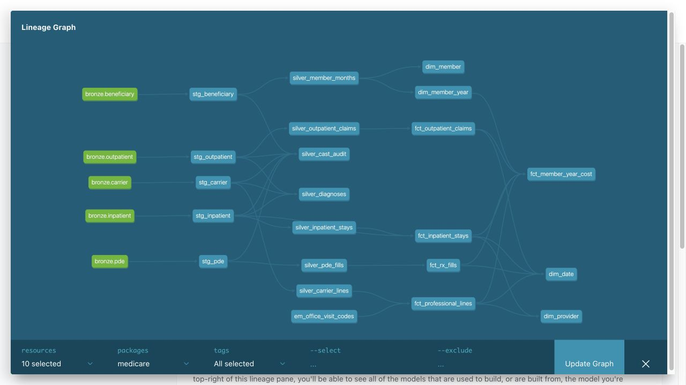

# Provider Performance Analytics on Medicare Claims

Build a reproducible warehouse of synthetic Medicare claims to compare provider
cost, utilization, and readmission rankings under two attribution methods.
Later checkpoints add a dashboard and an evaluated analytics assistant.

**Status: Step 12 assistant implementation verified and published in draft PR #13. Live generation and paid evaluation are deferred by user request; see [checkpoint evidence](docs/steps/12-assistant.md).**

## Work checkpoint by checkpoint

Each step includes implementation, verification evidence, and notes covering
what we did, why it matters, and how to explain it in an interview. On October 10,
2026, the user authorized continuing the full project and committing and pushing
each verified step without further approval prompts. Each checkpoint retains its
verification evidence and notes. Existing draft PRs remain unmerged.
Repository: [medicare-claims](https://github.com/karthikeyansett1/medicare-claims).

See [the roadmap](docs/roadmap.md), [Step 0 notes](docs/steps/00-setup.md),
[Step 1 notes](docs/steps/01-data.md), and [the decision log](docs/decisions.md).

## Local setup

From this folder, with Docker Desktop running and uv installed:

```sh
cp .env.example .env
# Edit PG_PASSWORD in .env. Do not put real credentials in .env.example.
make setup
make db-up
make verify
```

Python 3.11 and dependencies must download successfully before setup is complete.
PostgreSQL is bound to localhost. Connection helpers load .env relative to the
project root, and existing environment variables take precedence.

The full `make all` pipeline will be added as its stages are implemented.
GitHub authentication is needed only for publication, not local development.
The local folder remains `Project 3`; the GitHub repository name is `medicare-claims`.

## Get and verify Samples 1 and 2

```sh
make download
make verify-data
make test
```

Source ZIPs and extracted claims use about 7 GB locally and stay out of Git.
The small reference files and `data/manifest.csv` are versioned. See
[source provenance](docs/data_sources.md) for the archived CMS 2010 file used
because the current Sample 1 link points to Sample 20. The manifest contains
locally calculated SHA-256 checksums, download times, and source URLs.

Acquisition checks cover sixteen CSVs, three CMS PDFs, and the CCS source
files. `MEDICARE_SAMPLES=1,2` selects both samples by default; set it to `1` for
a deliberate single-sample run. Full source profiles are kept separately.

## Raw data profile

```sh
make profile
```

The [Sample 1 profile](docs/data_profile.md) covers 11,494,963 rows and the
[Sample 2 profile](docs/data_profile_sample_2.md) covers 11,509,982 rows. All
sixteen file counts match CMS Table 2: **23,004,945 raw rows** combined. Both
profiles check complete files, beneficiary membership, source hashes, segmented
claims and exact monetary totals. See [Sample 2 integration](docs/steps/11b-sample2.md)
for atomic loading and combined validation. Historical Step 0–11 notes describe
the original Sample 1 checkpoint; current reconciliation reports cover both samples.

See [Step 2 notes](docs/steps/02-profile.md) for the explanation and verification,
and [profiling decisions](docs/profile_interpretation.md) for financial and grain
definitions. The Step 2 checkpoint passed 22 tests. Step 2 publication is approved on `step-02-profile`.

## Load and reconcile bronze

```sh
make bronze         # verify/acquire source files and refresh all five tables
make verify-bronze  # read-only reconciliation against the source profile
make test-db        # complete test suite, including isolated PostgreSQL tests
```

The load uses COPY in one transaction, preserves source field values as TEXT,
and adds sample/file/year/time lineage. A successful rerun replaces the five
tables rather than appending duplicates. A failed load rolls back the batch.
The tables are UNLOGGED and rebuildable; they are not crash-durable.

[Reconciliation results](docs/bronze_reconciliation.md) show zero row-count
differences and agreement across 56 per-file financial sums.
[Step 3 notes](docs/steps/03-bronze.md) explain the design and its verification.
Step 3 publication is approved on `step-03-bronze`.

The complete local suite now passes **34 tests**, including six database integration cases.

## Build and reconcile staging and silver

```sh
make dbt-debug
make silver         # builds five staging and seven silver tables, with dbt tests
make verify-silver  # independently compares counts and exact monetary totals
```

[Step 4 notes](docs/steps/04-silver.md) explain the models, source-grain decisions,
cast auditing, enrollment limitations, and how to discuss the work in interviews.
Carrier lines retain payments without HCPCS. Facility claims retain every segment
payment and flag conflicting headers. Annual enrollment is a screening proxy,
and prescription gross cost remains separate from medical Medicare paid.

The entire dbt graph must pass before downstream analysis; its table rebuilds
are individually transactional, not a single atomic warehouse refresh.

[Silver reconciliation](docs/silver_reconciliation.md) confirms 9,388,987 carrier
lines, 12,733,072 diagnosis positions, and complete financial reconciliation.
[Build evidence](docs/silver_build_verification.json) records all 12 successful
models, 19 data tests, 5 unit tests, and the 34 passing Python regression tests.

## Gold star schema

```sh
make gold
make verify-gold
make benchmark-gold
make dbt-docs
```

The nine gold models include four dimensions, four detailed claims facts, and
a member-year cost summary. [Step 5 notes](docs/steps/05-gold.md) describe the
grains, verification, performance experiment, and interview explanation.
[Financial definitions](docs/measure_definitions.md) keep medical Medicare paid,
carrier allowed charges, prescription gross cost, and patient pay distinct.

[Independent verification](docs/gold_reconciliation.md) compares 5,853,015
member-year fields. Costs outside the enrollment window and undated outpatient
claims remain explicit, and enrollment-only years retain zero-event records.
The [index experiment](docs/gold_index_benchmark.md) records actual timings and
its limitations. Run verification after dbt refreshes finish, never concurrently.

Step 4 is published in [draft PR #4](https://github.com/karthikeyansett1/medicare-claims/pull/4).
Step 5 is published in [draft PR #5](https://github.com/karthikeyansett1/medicare-claims/pull/5); no earlier PRs have been merged.



To explore the generated docs locally after `make dbt-docs`, run:

```sh
.venv/bin/python -m http.server 8085 --bind 127.0.0.1 --directory dbt_project/target
```

Then open [local dbt Docs](http://127.0.0.1:8085). Generated catalog/compiled files
stay local; the lineage screenshot is versioned. Marts and CCS grouping follow
in their scheduled checkpoints.

## Data quality

```sh
make dbt-deps
make sql-lint
make quality-build
make verify-silver
make verify-gold
make test-db
```

Run independent reconciliation after the build completes. Broken contracts stop
the build; source anomalies remain visible as warnings. The current warning
counts are 278 missing service dates, 2,621 events with negative payment
components, and 11,043 facility header conflicts. No event starts more than 30
days after the earliest observed member death date. These counts describe
synthetic source data, not real clinical findings.

See [Step 6 notes](docs/steps/06-quality.md) for what, why, and the interview
explanation, and [verification evidence](docs/quality_verification.md) for the
full test counts and scope. All 146 silver and 53 gold independent checks passed.
CCS coverage and attribution checks are included with Steps 7 and 8.

## Attribution checkpoint

Run `make attribution` and `make verify-attribution`. See [Step 7 notes](docs/steps/07-attribution.md)
for rules, limitations, and interview explanation, and [spot checks](analysis/attribution_spot_check.md)
for five reproducible agent-verified examples.

## Clinical grouping

Run `make grouper` and `make verify-grouper`. See [Step 8 notes](docs/steps/08-grouper.md),
[coverage evidence](docs/ccs_verification.md), and the
[principal versus any-position comparison](analysis/ccs_sensitivity.md).

Step 9: `make readmissions && make verify-readmissions`. See [readmission notes](docs/steps/09-readmissions.md) and [canonical specification](assistant/measure_definitions.md).

### Provider metrics and pipeline order

`make pipeline-build` builds core dbt models, fits the 2008 risk model, then builds
the dependent provider mart. On an already built core, use `make metrics` followed
by `make verify-metrics`. Initial clean source setup/bronze loading is still required.
Expected-cost fitting deliberately fails on insufficient training data or invalid
predictions; CI fixtures must contain at least 31 eligible 2008 records.
Read [metric definitions](docs/measure_definitions.md) before interpreting PMPM or O/E.

### Attribution sensitivity

`make compare verify-comparison` generates and independently checks the Step 11
exports separately for each sample and performance year. Switching attribution
changes both member panels and provider rankings; the refreshed findings report
all four sample/year cohorts and the current largest global mover. These are
synthetic methodology effects, not real-provider conclusions.
See [measured findings and three charts](analysis/findings.md),
[exact comparison policies](docs/steps/11-comparison.md), and
[verification results](analysis/output/verification.json).


### AI assistant

Step 12 adds a real OpenAI Responses pipeline: structured query proposal, SQLglot
validation, a dedicated read-only PostgreSQL role, and a grounded answer from
returned rows. Run `make assistant-role` then `make assistant` after configuring
`LLM_API_KEY` privately. The UI defaults to Sample 1, 2009, Method A; eight prompt
examples are separate from the future evaluation set. See [assistant notes and
verification](docs/steps/12-assistant.md), including API smoke status, spending
bounds and the pooled-sample CCS limitation. Step 13 is the held-out evaluation;
public deployment follows later.
