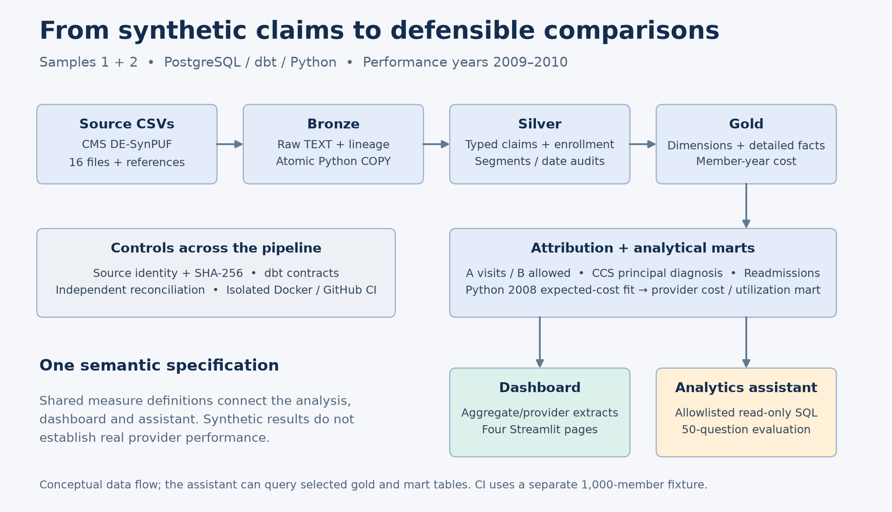
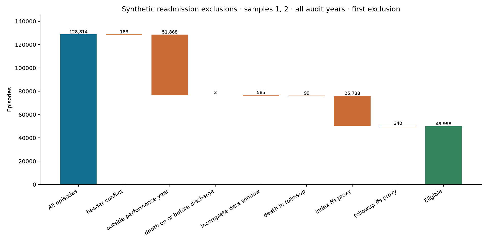
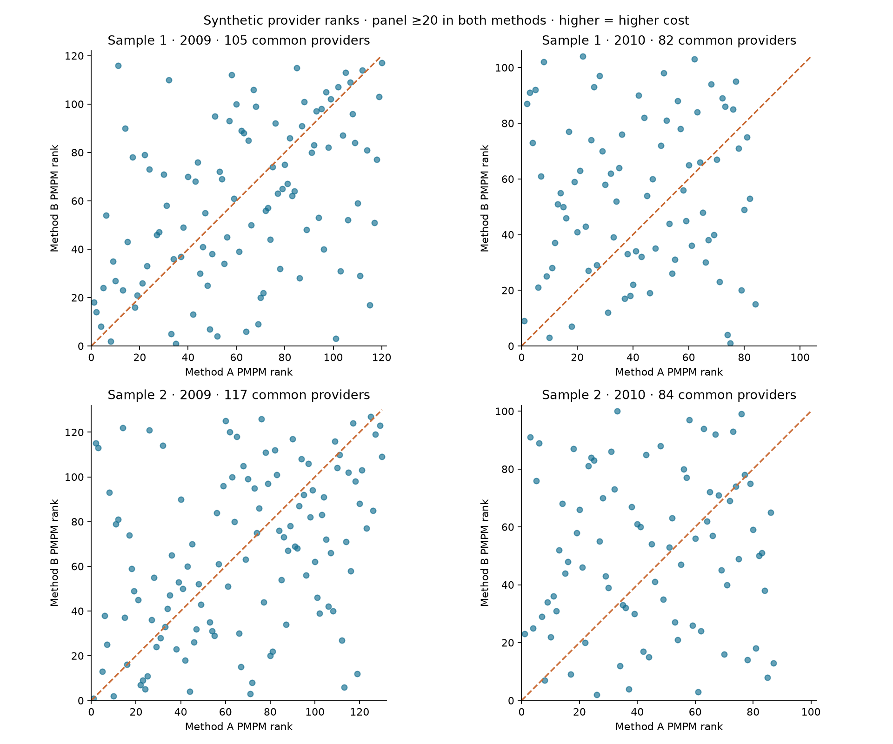
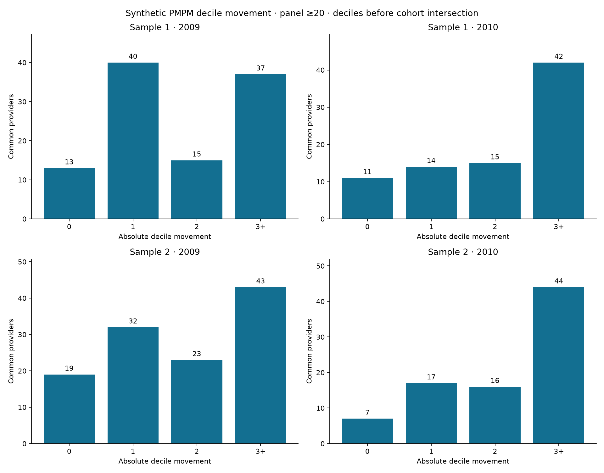
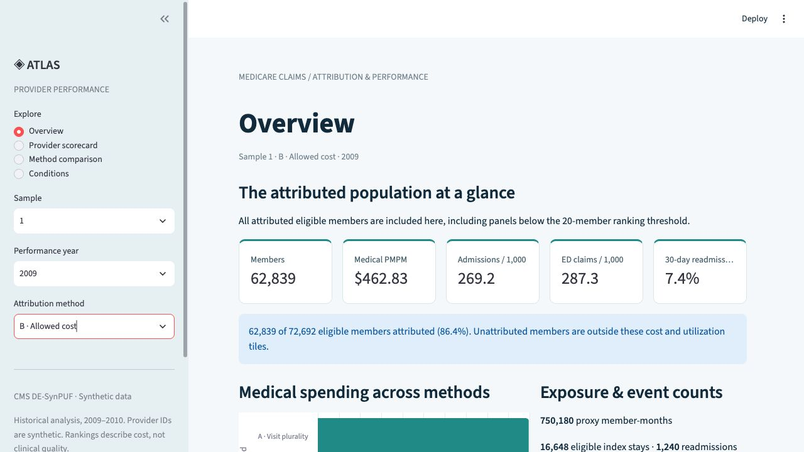
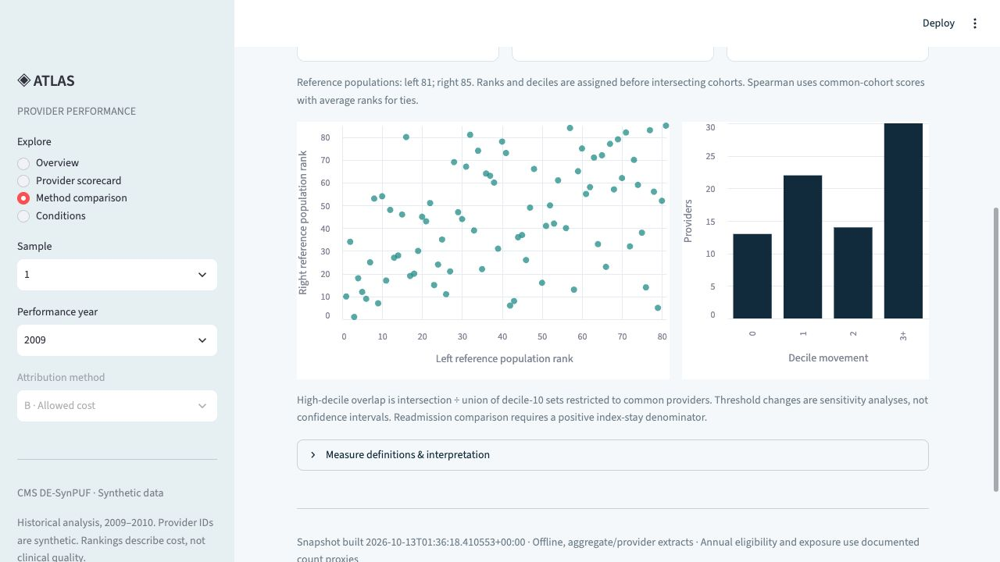
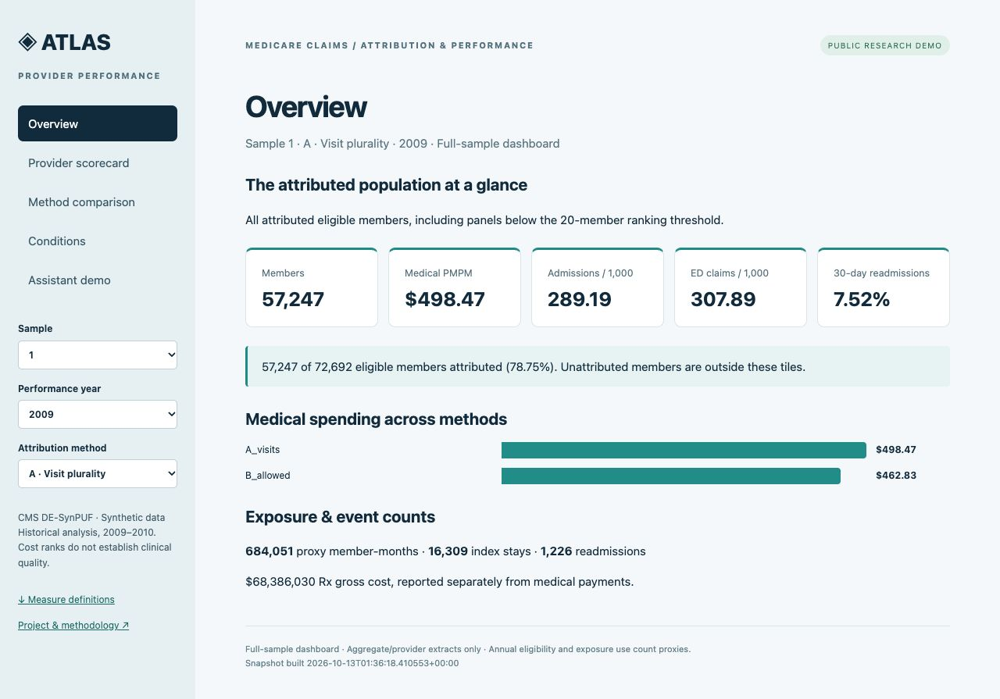

# Provider Performance Analytics on Medicare Claims

## Project purpose and reading guide

This manual explains how the project turns historical synthetic Medicare claims into an auditable provider analytics warehouse, compares provider attribution rules, and adds a constrained analytics assistant. It is intended for the project owner to reproduce the work, understand each design decision, and explain the project in an interview. Each checkpoint describes the implementation, the reason for it, verification evidence, and a suggested explanation in the owner's voice.

The completed two-sample warehouse contains **23,004,945 raw rows and 232,747 synthetic members**. Its central result is methodological: **35.2% to 52.4% of common qualifying providers moved at least three medical-cost deciles** when attribution changed. The source data, enrollment proxies, retrospective assignment, and model calibration limit any clinical interpretation. These are synthetic identifiers and historical utilization patterns, not evidence about real provider quality.

The public dashboard presents aggregates from both full samples. Its four Assistant examples are saved SQL results from a separate 1,000-member engineering fixture. They are explicitly labeled demonstrations, not responses from a live public AI service. The locally implemented assistant can call OpenAI with a saved key and query a restricted role. Paid evaluation results are documented separately from code and database tests.

The chapters follow Steps 0 through 17 of the build, including the additional Step 11b integration. Early checkpoint counts refer to Sample 1. Current combined evidence appears in Step 11b and the findings chapter. Historical results remain archived so an older 11.5-million-row result is not confused with the final 23-million-row scope.

This manual was agent-drafted from repository evidence. Suggested interview explanations are practice wording; the owner should understand and adapt them. Agent checks are not represented as independent human or clinical review.

## Architecture and important terms



The pipeline moves through verified files, raw PostgreSQL tables, typed dbt models, analytical facts and dimensions, and provider-level outputs. The assistant receives the curated semantics of seven approved tables; it never receives unrestricted database authority. CI rebuilds an isolated fixture, while the public dashboard loads exported aggregate data.

**Bronze** preserves source fields and provenance. **Silver** converts types and resolves physical source structure into defined analytical rows. **Gold** supplies dimensions and facts suitable for controlled joins. A **mart** is a table organized for a specific reporting question. dbt expresses dependencies between SQL models and runs their tests.

The **grain** is what one row means. A beneficiary-year, carrier line, facility claim, merged admission episode, and provider-year panel are different grains. Joining two sets of events directly can create a many-to-many multiplication called **fanout**. The project first aggregates each fact to member-year before combining financial measures.

A **denominator** defines the population or exposure for a measure. Attribution coverage divides assigned members by all eligible members. Reassignment divides changed assignments by members assigned under both methods. PMPM divides paid dollars by member-months. Readmission rates divide qualifying readmissions by eligible index episodes. Those denominators answer different questions and must not be substituted.

A **reconciliation** compares quantities through an independent calculation. A dbt test can detect a duplicate key; a source-to-warehouse payment check detects money lost during transformation. Both are needed. A passing test verifies its stated contract, not every possible clinical or analytical interpretation.

## Step 0 Establish a reproducible foundation

### Implementation and rationale

The project starts with Python 3.11, a virtual environment, locked dependencies, PostgreSQL 16 in Docker Compose, database initialization SQL, and a shared connection module. The folder structure separates ingestion, dbt transformations, analysis, assistant code, tests, documentation, and deployment. Git ignore rules keep credentials, raw claims, virtual environments, and private logs out of source control.

Central connection settings avoid scripts silently reaching different databases. The local `.env` is private with mode 0600. It is parsed as configuration rather than executed as shell code. The shared Python helper supports both psycopg and SQLAlchemy. Initial testing caught SQLAlchemy requiring `username` where the psycopg settings used `user`; fixing the adapter mapping established both connection paths before data work began.

### Verification and reproduction

The initial checkpoint verified Python 3.11.16, dependency compatibility, Compose syntax, database health, startup schemas, imports, both connection helpers, and ignore rules. Use `make setup`, `make db-up`, and `make verify` after configuring local settings. Files to inspect are `requirements.in`, `requirements.txt`, `docker-compose.yml`, `ingest/db.py`, and `sql/init/01_schemas.sql`.

### Interview explanation

“I made the environment reproducible before analyzing claims. I locked dependencies, configured PostgreSQL in Docker, centralized connections, and separated secrets from tracked code. That let me distinguish environment failures from data and modeling failures.”

Evidence: `docs/steps/00-setup.md` and the repository Makefile.

## Step 1 Acquire and authenticate the source files

### Implementation and rationale

The acquisition pipeline downloads eight files per sample: three beneficiary years, inpatient, outpatient, two carrier parts, and prescription drug events. It also retains CMS documentation, the AHRQ CCS mapping, and a ten-code historical office E&M reference. Source URLs, expected filenames, byte sizes, and SHA-256 hashes establish reproducible provenance. ZIP CRC checks and safe extraction checks detect corrupt archives and unsafe members.

A real source issue appeared immediately: the current CMS Sample 1 page pointed its 2010 beneficiary link to Sample 20. The downloader rejected that mismatch. The project recovered the original Sample 1 file through an archived CMS source, recorded the provenance, and checked that later-year beneficiary IDs belonged to the 2008 population. A recognizable filename alone would not have established that the sample was correct.

### Verification and reproduction

Sample 1 contained eight verified CSVs, 379,065,352 compressed bytes, and 3,119,692,771 extracted bytes. The checkpoint's 17 tests covered wrong samples, redirects, corrupt cache bytes, unsafe archive paths, incomplete responses, invalid headers, and cache reuse. `make download` acquires or verifies cached files; `make verify-data` performs local checks. Current defaults select Samples 1 and 2.

### Interview explanation

“I verified source identity as well as download success. A mislabeled CMS link would have mixed two samples, so I rejected it, recovered the correct historical file, and documented the source and hashes. The pipeline can reuse verified inputs without silently accepting changed files.”

Evidence: `ingest/urls.yaml`, `ingest/download.py`, `data/manifest.csv`, and `docs/data_sources.md`.

## Step 2 Profile every source before designing joins

### Implementation and rationale

The profiler scans complete CSVs in chunks and uses temporary SQLite storage for exact distinct keys across chunks. It measures row counts, missingness, date validity, duplicate and segmented claims, provider identifiers, diagnosis coverage, and exact monetary totals. Separate sample contexts prevent equal raw identifiers in different samples from contaminating one another's diagnostics.

Profiling established two important corrections. Outpatient data contain segments, so a source row is not necessarily a whole claim. Carrier records contain up to 13 service slots; requiring a nonblank procedure code would discard payment-bearing activity. Prescription gross cost also differs from Medicare medical paid amounts and must remain separate.

### Verification and reproduction

The original scan covered all 11,494,963 Sample 1 rows and matched CMS counts. It found $20,695,070 in carrier paid amounts without HCPCS, 68 multisegment inpatient claims, 10,975 multisegment outpatient claims, and 2,621 negative facility payment values. The later combined missing-HCPCS paid amount is $41,335,020. This is preserved source spending, not recovered revenue or an estimate of fraud.

Run `make profile`. Reports are `docs/data_profile.json`, `docs/data_profile.md`, and the corresponding Sample 2 files. The original checkpoint passed 22 automated tests, including exact cents, invalid calendar dates, and duplicates crossing chunk boundaries.

### Interview explanation

“I established the source grain before modeling. Full-file profiling caught a filter that would have removed payment-bearing carrier lines and showed that facility records required segment aggregation. Those measurements became the independent targets for later reconciliation.”

## Step 3 Load bronze atomically

### Implementation and rationale

Five bronze tables hold beneficiary, inpatient, outpatient, carrier, and prescription records. All source fields are TEXT so loading does not erase leading zeros, blanks, unusual codes, or negative values. Every row receives sample, source-file, load-time, and applicable file-year lineage. psycopg streams CSV through PostgreSQL COPY rather than issuing individual inserts.

The loader validates file hashes and compatible headers before mutation, takes an advisory lock, and refreshes the batch in one transaction. A failed file, count, or financial check rolls back the batch. UNLOGGED tables reduce write-ahead logging because the verified source can rebuild them; they are not guaranteed to survive an unclean server crash.

### Verification and reproduction

The original load committed 11,494,963 rows and matched 56 per-file financial column sums. Isolated integration tests covered rerun behavior, raw-value preservation, schema rejection, malformed data, changed hashes, and whole-batch rollback. The combined load later accepted all sixteen files in one transaction.

Use `make bronze` to replace bronze from the selected sources and `make verify-bronze` for read-only reconciliation. `make test-db` runs database integration cases in isolated test schemas. Never run two separate single-sample refreshes expecting the results to append; the loader intentionally replaces the target tables.

### Interview explanation

“I preserved the source in a raw layer and made refreshes atomic. I used COPY for bulk loading and committed only after counts, lineage, hashes, and money matched the source profile. A partial failed refresh cannot become the new completed warehouse.”

Evidence: `ingest/load_bronze.py` and `docs/bronze_reconciliation.json`.

## Step 4 Create typed silver models

### Implementation and rationale

Five staging models retain source rows while converting dates, exact monetary numbers, and flags. Identifiers remain text. Blank values become NULL; chronic flags 1 and 2 become true and false, while missing values remain unknown. Invalid nonblank casts are visible in an audit rather than silently treated as valid missing data.

Silver expands active carrier slots into individual professional lines, retains diagnosis positions, groups facility segments, and creates annual enrollment and prescription models. A carrier slot is active when clinical/provider identifiers or nonzero paid or allowed amounts indicate activity. Missing HCPCS does not justify dropping its money. Canonical facility headers use a documented segment convention, and disagreement flags remain available.

### Verification and reproduction

The final combined warehouse retains 18,787,937 professional lines and 25,478,615 diagnosis positions. Independent silver reconciliation passes 151 checks. These combined counts supersede the earlier Sample 1 checkpoint for current scope. Date order, grain, cast behavior, code domains, and amount preservation receive separate checks.

Run `make silver` on loaded bronze and `make verify-silver` after the build finishes. Inspect `dbt_project/models/staging`, `dbt_project/models/silver`, and `ingest/verify_silver.py`.

### Interview explanation

“I converted raw fields into explicit types and analytical grains while preserving traceability. I retained missing-code payments, negative adjustments, and conflicting headers, then tested that those transformations preserved source counts and dollars.”

## Step 5 Build gold dimensions and facts

### Implementation and rationale

Gold separates member, annual member, provider, and calendar dimensions from professional, inpatient, outpatient, and prescription facts. A member dimension can describe the latest known demographics, while the annual dimension preserves historical coverage and condition values. Keys include sample identity. A synthetic provider identifier is not a verified real-world identity or specialty.

The canonical member-year cost summary aggregates each fact independently before joining. Medical paid equals inpatient plus outpatient plus professional paid. Professional allowed, prescription gross, and prescription patient payment remain separate. Patient payment is already a component of gross prescription cost, so adding them would double count.

Dates allocate entire event payments to years using documented conventions. Pre-2008 and undated costs remain visible rather than disappearing because they lack a standard performance-year enrollment match. Indexes and ANALYZE support tested queries; an index is not a promise that every query will use an index scan.

### Verification and reproduction

The final gold audit passes 54 checks and 11,709,022 member-year field comparisons. Gold contains 232,747 members, 687,502 enrolled member-years, 133,139 inpatient claim-based stays, 1,561,368 outpatient claims, and 11,113,575 prescription events. These are different units, not additive counts of people.

Use the ordered `make pipeline-build` for a current complete build; `make verify-gold` checks gold independently. Inspect `gold.fct_member_year_cost` and the canonical definitions before writing financial SQL.

### Interview explanation

“I designed dimensions and facts around their true grains and built one canonical annual cost summary. Aggregating facts before joining prevents fanout, and explicit financial definitions prevent allowed charges or drug gross cost from being mislabeled as Medicare paid.”

## Step 6 Make data quality an executable contract

### Implementation and rationale

Structural failures stop the build: duplicate keys, broken relationships, invalid casts or codes, and unreconciled financial amounts invalidate downstream analysis. Known source anomalies are retained and counted as warnings. Negative adjustments and missing dates cannot be deleted just to produce a clean report.

Warning monitors cover conflicting facility headers, missing service dates, negative medical payments, and events starting more than 30 days after death. Boundary fixtures distinguish exactly 30 days from the first day beyond it. SQLFluff checks the dbt-expanded SQL for the configured formatting and correctness rules.

### Verification and reproduction

In the combined core rebuild, 154 nodes passed and three expected warnings remained across 157 nodes. That build included 32 table models, two seeds, 107 data tests, and 16 unit tests. The warnings counted 22,112 facility header conflicts, 470 missing service dates, and 5,236 negative medical payment records. Later dependent metrics have their own ten-node build; do not call the total node count a test count.

Use `make sql-lint`, the ordered pipeline build, then independent verifiers. Never reconcile concurrently with dbt writes: a verifier can otherwise observe a temporary replacement state. Warning counts should be compared with their source scope and prior evidence.

### Interview explanation

“I separated pipeline-breaking errors from documented source anomalies. Keys and reconciliation are hard failures. Known irregularities remain visible with warning counts, because dropping them would change the source totals and hide uncertainty.”

## Step 7 Define two deterministic attribution rules

### Implementation and rationale

Retrospective attribution assigns eligible member-years in 2009 and 2010 to a provider using two explicit rules. Method A selects the rendering NPI with the most distinct office E&M dates, then the most recent office date, then the lowest text NPI. Multiple lines on one date count once.

Method B selects the greatest sum of known professional allowed amounts across all professional lines, then the most distinct service dates, then the lowest NPI. An all-unknown amount candidate cannot win. A known zero or negative amount is valid; missing-amount counters reveal incomplete totals. Allowed amounts drive this assignment even though medical paid drives the PMPM outcome.

Candidate evidence and winner tables retain ties and coverage. Every eligible member-year has exactly one row for each method, including an explicit unattributed row when no candidate exists. Small panels remain in attribution; the reporting minimum does not rewrite assignments.

### Verification and reproduction

The combined independent verifier reconstructed 544,210 assignments from 8,068,321 fact lines with zero mismatches. Those assignments represent two methods for 272,105 eligible member-years, not 544,210 distinct people. Four unit fixtures exercise dates, ties, unknowns, signed amounts, eligibility, and sample collisions.

Run `make attribution` and `make verify-attribution`. Inspect candidate evidence before explaining a winner.

### Interview explanation

“I made provider responsibility a measurable rule rather than an assumption. I compared visit-day plurality with allowed-cost plurality, retained deterministic tie breakers and unattributed members, and independently reconstructed every assignment from the underlying lines.”

## Step 8 Group diagnoses without multiplying cost

### Implementation and rationale

The project cleans the public 2015 single-level ICD-9-CM CCS mapping into 15,072 unique nonblank codes. Trimming quotes, spaces, case, and decimal punctuation is consistent; leading zeros and V/E prefixes survive. The cleaner rejects conflicting duplicate mappings and does not invent missing digits.

A left join preserves unmatched diagnosis positions. The additive inpatient cost mart assigns each claim-based stay to exactly one category using its canonical principal diagnosis, including an explicit UNMAPPED category. All payment, including negative adjustments, is conserved.

An additional any-position analysis assigns a distinct stay/category pair for every diagnosis category observed. A stay can then belong to several categories. That comparison is useful for sensitivity but its category dollars are nonadditive. The 2015 reference applied to 2008–2010 synthetic claims is also a retrospective grouping choice.

### Verification and reproduction

Combined coverage is 99.9471% of source diagnosis positions. Independent reconstruction checked 820 category/year groups and $1,273,323,410 in inpatient paid. Run `make grouper` and `make verify-grouper`; inspect `analysis/ccs_sensitivity.md` for the principal-versus-any-position comparison. The condition mart pools all loaded samples and has no sample column.

### Interview explanation

“I used one principal diagnosis category per stay to preserve an additive cost total, kept unmapped codes visible, and separately showed how any-diagnosis grouping changes the ranking. I labeled overlapping category costs so they cannot be mistaken for unique total spending.”

## Step 9 Specify readmissions before writing SQL

### Implementation and rationale

The readmission specification defines episodes, observation windows, exclusions, and denominators before implementing them. Intervals are merged using the running maximum discharge of preceding intervals. This handles nested overlaps and same-day transfers that a simple previous-row comparison can miss.

The next admission is computed across all dated episodes before filtering index eligibility. A qualifying numerator is a next admission 1 through 30 days after discharge. Day 31 does not qualify. Chained readmissions can themselves become indices. Invalid dates, current or next header conflicts, death, incomplete end-of-data follow-up, and enrollment proxies are explicit exclusions. A member with an undated inpatient episode is conservatively excluded because the next admission cannot be established reliably.

The denominator uses 2009/2010 discharges and annual FFS screening proxies. Annual enrollment counts cannot prove continuous monthly coverage. There is no planned-readmission exclusion, clinical adjudication, or risk adjustment of this readmission measure.

### Verification and reproduction

Combined reconstruction checked 1,674,582 fields across 128,814 merged audit episodes. It retained 49,998 eligible indices and observed 3,233 readmissions, a rate of 6.4663%. The audit population includes 2008 and out-of-window episodes. Every source claim and its money remains accounted for even when excluded clinically.

Run `make readmissions` and `make verify-readmissions`. Boundary fixtures cover 1/30/31 days, December 1/2 cutoff, death, transfers, nested intervals, and cross-year coverage.

### Interview explanation

“I specified the denominator first, merged transfers and overlaps, and kept an ordered exclusion waterfall. The resulting rate is a reproducible synthetic measure with conservative observation rules, not an endorsed CMS quality score.”



## Step 10 Calculate provider metrics and expected cost

### Implementation and rationale

The provider mart has one row per sample, NPI, performance year, and attribution method. Medical PMPM divides medical paid by required member-months. Annualized admissions and ED proxy rates divide events by member-months and multiply by 12,000. Readmission rates use eligible index episodes. Zero denominators produce NULL.

Panels with at least 20 attributed members receive ranks and deciles within their sample/year/method. Deterministic NPI tie breakers make output repeatable. The threshold is a reporting policy, not proof of statistical reliability; a 20-member panel can still have very few readmission indices.

The expected-cost model fits an exposure-weighted positive conditional mean using a Poisson log-link loss with fixed regularization on eligible 2008 data. Features are age band, sex, and eleven concurrent chronic flags with explicit unknown handling. This loss choice does not claim dollar outcomes are Poisson counts. One negative 2008 member-year is excluded only from fitting; observed costs remain unchanged. Expected paid is predicted PMPM times required months.

### Verification and reproduction

Combined verification covers 323,458 provider panels, 872 reportable panels, and 4,531,900 numeric/ranking comparisons. Expected/observed aggregate paid ratios are 1.103 in 2009 and 1.160 in 2010, showing overprediction. Future-year diagnostics were inspected during development, so they are not untouched validation. Adjustment is descriptive, concurrent, and not a causal or clinical score.

`make pipeline-build` orders core dbt, the Python fit, and the dependent mart. Inspect `analysis/risk_model.py`, its JSON diagnostics, and `ingest/verify_metrics.py`.

### Interview explanation

“I used exposure months and independent fact aggregation, then compared raw cost with a positive expected-cost model. I disclosed calibration error and reporting thresholds rather than implying adjusted rankings were validated clinical quality.”

## Step 11 Quantify attribution sensitivity

### Implementation and rationale

The comparison checks coverage, member reassignment, medical PMPM, readmissions, raw versus adjusted rankings, and minimum panel thresholds of 10, 20, and 30. Ranks and deciles are computed within each full qualifying method population before intersecting providers. Re-ranking only the common providers would answer a different question.

Spearman correlation uses common providers and average ranks for ties. Operational deciles use PostgreSQL NTILE with deterministic NPI tie breakers. Small groups, constant vectors, and empty unions receive explicit unavailable results instead of misleading numeric defaults. High-cost overlap is a Jaccard ratio: providers in both top-decile sets divided by providers in either set.

### Combined findings

| Sample and year | Common providers | PMPM Spearman | Moved at least three deciles |
| --- | ---: | ---: | ---: |
| Sample 1 2009 | 105 | 0.412 | 37 of 105 or 35.2% |
| Sample 1 2010 | 82 | 0.017 | 42 of 82 or 51.2% |
| Sample 2 2009 | 117 | 0.353 | 43 of 117 or 36.8% |
| Sample 2 2010 | 84 | 0.055 | 44 of 84 or 52.4% |

Among members assigned under both methods, 85.9% to 88.0% change provider across the four cohorts. That denominator differs from overall coverage. The result demonstrates sensitivity to attribution, not that either rule identifies the correct provider.

The largest current mover is synthetic NPI 2639271506 in Sample 2, 2009. It moves from decile 10 to 1 and PMPM $730.95 to $329.42. Only two members remain; 19 leave and 24 enter. Outgoing members' medical paid exceeds incoming members' by $81,420. This is a cohort-composition explanation, not evidence that the attributed provider's delivered care changed.

### Verification and interview explanation

The combined verifier checks 60 comparisons, 6,991 provider pairs, 28,684 SQL numeric values, and 3,104 mart ranks/deciles. Run `make compare verify-comparison` after the warehouse is stable. Repeated outputs and all three charts were checked.

“I found that the responsibility rule substantially changes rankings. I preserved the full reference populations and traced a large movement to changing panel membership, rather than claiming the provider suddenly became more efficient.”





## Step 11b Integrate the second sample safely

### Implementation and rationale

Sample 2 adds eight separately authenticated and profiled files. Shared sample configuration defaults to `MEDICARE_SAMPLES=1,2`. Raw member and provider identifiers remain text, but all keys and joins include sample identity. The loader validates all sixteen file plans and compatible columns before one atomic replacement. Loading each sample in a separate refresh would erase the first sample.

Historical Sample 1 evidence is retained in `docs/checkpoints/sample_1`. Current reports reflect both samples. Rankings stay partitioned by sample and year. The expected-cost model is refit on pooled 2008 records, so Sample 1 adjusted results may change even though its original raw data have not changed.

### Verification and reproduction

| Source group | Sample 1 rows | Sample 2 rows |
| --- | ---: | ---: |
| Beneficiary years combined | 343,644 | 343,858 |
| Inpatient | 66,773 | 66,494 |
| Outpatient | 790,790 | 792,562 |
| Carrier parts combined | 4,741,335 | 4,745,914 |
| Prescription events | 5,552,421 | 5,561,154 |
| Total | 11,494,963 | 11,509,982 |

All sixteen source counts matched CMS. Combined bronze committed 23,004,945 rows with exact financial reconciliation. The integration suite passed 63 tests without skips. Silver and gold together passed 205 checks. This checkpoint also refreshed findings and figures so the largest-mover story reflected the combined analysis.

Run download, verification, profiling, bronze, pipeline build, then all independent verifiers in that order. Full instructions are in `docs/steps/11b-sample2.md`.

### Interview explanation

“I expanded to a second independent sample without losing the first or colliding identifiers. I separated profiling contexts, combined the load into one transaction, rebuilt downstream models, and kept rankings within sample/year populations.”

## Step 12 Constrain the analytics assistant

### Implementation and rationale

The assistant sends curated table semantics, canonical definitions, eight training examples, the user's question, and explicit default sample/year/method to the configured model. A structured plan contains assumptions, SQL, or a clarification. Valid SQL executes through the dedicated read-only role; a second model request explains the actual returned rows. One repair is allowed after validation or database error.

A seven-table semantic layer describes every column, grain, and permitted join. It tells the model that medical paid excludes prescription gross cost, provider ranking requires a reporting population, and the CCS mart is pooled across samples. Ambiguous or unavailable measures require clarification rather than an invented query.

SQLglot parses the entire PostgreSQL syntax tree. The policy accepts one SELECT, including allowed nonrecursive SELECT-only CTEs, and rejects nested writes, SELECT INTO, row locks, unknown tables/columns, table functions, and unapproved functions. Schema-qualified physical tables are required. Output is capped at 500 rows, with byte limits and a cumulative 20-second execution deadline. These controls make SQL safer; semantic correctness still needs evaluation.

### Independent execution controls

The `assistant_ro` role has exactly seven SELECT grants and lacks write/create authority. Read-only transactions and default settings add another layer. Actual INSERT attempts were denied even after disabling the default read-only setting, demonstrating privilege enforcement independently. dbt grants preserve the boundary after table replacement.

A shared SQLite ledger reserves budget before requests, enforces rate and daily limits, and retains reservations after failures. Logs exclude secrets and raw question/answer content. SDK retries are disabled, requests time out, and provider storage is disabled. A token reservation is not automatically a verified dollar cap.

### Verification and interview explanation

The implementation checkpoint passed 114 database-enabled Python tests, including 47 assistant unit/adversarial tests. All eight example queries, exact grants, column catalog, and denial probes passed. Successful generated smoke and fixed-set model results are separate evidence described in Step 13.

“I separated the model's proposed query from authority to execute it. Curated semantics, AST validation, and database privileges each enforce a different boundary. Safe SQL can still use a wrong denominator, so I evaluate analytic correctness separately.”

## Step 13 Evaluate generated answers against independent gold queries

### Evaluation design

The evaluation set, initially held out from the training examples, has 50 questions: eight lookup, eight aggregation, eight attribution-method, ten measure-definition, six comparison, five denominator-trap, and five clarification cases. Gold SQL remains outside runtime prompts. The eight training examples are separate. The offline harness verified 45 SQL executions and five clarification cases; that establishes reference executability, not model accuracy.

The comparator checks result shape, column positions, NULLs, booleans, dates, and duplicate multiplicity. Numeric tolerances allow small legitimate differences. Unordered rows use bipartite matching rather than a greedy match that can mishandle nearby values. Ranking cases can require order. A clarification passes only with empty SQL and nonempty clarification text.

A live run records model, code, prompt, semantic-layer, dataset, and budget identities. Resume requires those identities to match. Operational errors stop execution, and unknown usage stays unknown. The warehouse must remain frozen during the run. The completed cycle contains one v1 run, general fixes based on diagnosed failures, and three v2 runs to measure repeatability.

### Completed real API evaluation

All eight training-example smoke cases completed: seven strict matches, with the remaining answer returning correct requested values plus an extra diagnostic column. The $0.471646 estimated smoke cost is included in the campaign totals below. Training examples are not held-out accuracy evidence.

The complete v1 baseline scored **39/50 (78%)**. After three general prompt corrections, v2 scored **49/50 in each of three runs**, or **147/150 strict matches**. The observed range was 98%–98%, with population standard deviation 0.00 percentage points. Every completed run executed all 45 SQL cases and passed all five clarification cases. Three repetitions do not establish universal reliability.

The real Responses API runs used `gpt-6-astra`, standard tier, low reasoning, and a 3,000-output-token cap. Temperature was omitted; these were not temperature-zero trials. V2 adds general instructions to return only requested measures/grouping dimensions, preserve numeric precision unless rounding is requested, and preserve empty SUM as NULL unless definitions require zero. The question set, gold queries, comparator, schema, definitions, and few-shot examples were unchanged.

**V2 is a fixed-set regression measurement, not untouched held-out generalization.** Baseline failures informed the prompt improvements, so the same 50 questions cannot establish performance on unseen questions. The gold queries remain outside model prompts. A new independent set would be needed for a fresh generalization estimate.

### Reviewed failures and answer faithfulness

Each failure receives one of ten taxonomy categories. All eleven baseline failures were reviewed as Other: eight extra projections, one equivalent pivot shape, one extra projection with premature rounding, and one empty-SUM NULL-to-zero change. Nine preserve requested values under explicitly reviewed projection or pivot mappings; the strict baseline score remains 39/50.

Q06 returned the correct earliest service date with an unrequested NPI column. Q22 rounded the attribution fraction to 86.45 and added count columns, violating precision and shape. Q29 used COALESCE on an empty SUM, returning zero where the reference requires NULL. V2's only failure in each repetition was Q16: equivalent counts in a pivoted shape rejected by the positional contract. The three Q16 failures remain failures; they were not recoded to inflate accuracy.

SQL execution and strict result agreement do not guarantee a faithful explanation. Fifteen question IDs were selected before paid outputs existed. **Codex agent review scored 15/15 for v1 and 15/15 for v2 repetition 1**, checking scope, method, year, definitions, and numerical statements against returned results. These are agent reviews, not independent human reviews; human review remains pending. Case-by-case evidence and literal excerpts are retained in each completed run's `faithfulness_review.json`.

### Cost control and interrupted runs

Measured usage-based cost was **$6.5081800**. Two timeout calls had unknown usage, so their full **$1.0315875** reservations remain charged against the budget. The conservative total is therefore **$7.5397675 against the $20 cap**, including both smoke stages and all evaluation attempts. This estimate is not an invoice, remaining account balance, or account-wide spend total. Unknown usage is not zero.

The configured rates, verified October 14, 2026, were $10 per million uncached input tokens, $1 per million cache-read tokens, $12.50 per million cache-write tokens, and $50 per million output tokens including reasoning. Cache writes are accounted for separately. These are the campaign's recorded rates, not a promise about future pricing.

V1 Q20 timed out during planning; v2 repetition 2 Q23 timed out during explanation after successful SQL. Each received one fresh attempt after user continuation. Original partial runs remain immutable and carry no aggregate accuracy. Completed lineage-linked runs reuse answered cases without resending them. Reservations occur before dispatch and settle only after bounded usage with verified model, tier, and cache accounting. Six-calls-per-minute pacing remained active. Public live AI remains disabled.

### Interview explanation

“I improved strict result agreement from 78% to 98% across three repeated runs by fixing output-contract instructions, while preserving the evaluation questions and gold queries. I describe the improvement as regression evidence because I inspected baseline failures. I also separately reviewed answer faithfulness and retained unknown timeout costs instead of treating them as free.”

Evidence: `eval/questions.yaml`, `eval/run_eval.py`, `eval/results/summary.md`, and `eval/results/final_evaluation_summary.json`. Completed lineage directories are `eval/results/v1_2026-10-14_resumed` and `eval/results/v2_2026-10-16_resumed`; each contains summary, failure review, faithfulness review, and immutable prompt evidence.

## Step 14 Build a dashboard with visible scope

### Implementation and rationale

The four pages cover Overview, Provider scorecard, Method comparison, and Conditions. Sample, year, attribution method, and reporting threshold controls expose choices that materially change results. The Overview uses weighted totals over all attributed members, not the average of provider PMPMs or only reportable panels. The scorecard applies its reporting threshold explicitly.

The Conditions page uses the pooled CCS mart. Sample and method controls are disabled there because the underlying table cannot support those filters. The interface provides canonical definitions and clearly labels the synthetic historical data. Aggregate exports avoid member records and make the dashboard portable without a warehouse connection.

### Verification and reproduction

Live browser checks exercised all four pages, method and sample changes, threshold 20 to 30, empty provider search, and a leading-zero NPI. The database-enabled checkpoint passed 129 tests. All eight overview cohorts reconciled to the full provider mart, and twelve sample/year/threshold comparisons passed. Export hashes and identifier privacy were also checked.

Run `make export` after analysis and `make dashboard` to open the local Streamlit app. The public static implementation presents the same full-data dashboard scope through browser-side controls.

### Interview explanation

“I made the analytical choices visible and validated the totals behind the screen. I used weighted population metrics and disabled filters the data could not support, so a polished interface would not conceal a denominator or scope error.”





## Step 15 Rebuild in isolated CI and Docker

### Implementation and rationale

GitHub Actions creates a fresh PostgreSQL 16 service, installs locked dependencies, loads a compressed fixture, builds dbt, fits expected costs, builds dependent metrics, compares methods, exports dashboard data, reconciles independently, lints SQL, and runs Python tests. CI makes no paid model calls.

The engineering fixture contains 1,000 Sample 1 members with every source row retained for those members. It combines 490 fixed anchor members with 510 additional seeded selections. Anchors preserve enough shared provider panels to exercise the actual reporting threshold and ten-provider deciles. This stratified fixture is designed for coverage of code paths, not representative statistical inference.

Deterministic gzip keeps eight source files and metadata at 4,151,256 bytes. Hashes, headers, member cohort, and row counts are verified before use. The fixture contains 111,643 source rows. Generated reports stay in an isolated output root so a test run cannot overwrite full-data evidence.

### Safety and verification

The dedicated CI Compose project has its own PostgreSQL cluster and volume. This matters because roles are cluster-global: a separate database in the production cluster would still risk changing the full assistant role. Runtime guards require explicit CI settings, a fresh cluster, and a marked isolated workspace.

Fresh Docker finished with exit code zero and all 133 Python tests passing. It covered 40 reportable panels and 688 readmission episodes. The full warehouse's 23,004,945 bronze rows and role credentials remained intact. The implementation GitHub Actions run 38442767433 passed. Deployment commit `dfbe933` also passed push run 38826989735 and PR run 38826995533. Later heads need their own CI result; historical success is not evidence for untested edits.

### Interview explanation

“I made CI small without weakening production rules. The fixture preserves full source schemas and enough panels for meaningful rank tests, while its cluster and output isolation protect the real warehouse and evidence.”

## Step 16 Write the methodology and project entry point

### Implementation and rationale

The README links measured results, diagrams, screenshots, canonical definitions, and reproduction commands. The methodology memo explains attribution, financial scope, readmissions, risk adjustment, exclusions, and limitations. It separates members, raw rows, member-years, test nodes, and reconciliation checks so the headline does not combine incompatible counts.

The architecture graphic describes the current system. The Step 5 dbt lineage is explicitly historical rather than presented as the final graph. Resume wording states implemented functionality and measured results without inventing clinical impact, human review, or AI accuracy. This walkthrough expands those concise artifacts into an explanation of every stage.

### Verification and interview preparation

Documentation figures were cross-checked against reconciliation JSON and comparison CSVs. Current core facts include 205 silver/gold checks, 272,105 eligible performance member-years, and 3,233 readmissions among 49,998 eligible indices. Markdown links and image outputs were checked. No database rebuild was needed merely to edit documentation.

The owner should be able to explain why prescription gross differs from medical paid, why a provider panel threshold is not a confidence guarantee, why condition data pool samples, and why concurrent risk adjustment is not forecasting. Suggested wording should be adapted to what the owner personally understands.

### Interview explanation

“I made the evidence and assumptions accessible to a reviewer. The documentation ties each claim to its population and verification, and explains why large ranking changes reflect attribution sensitivity rather than a causal change in care quality.”

Evidence: `docs/methodology_memo.md`, `docs/interview_prep.md`, and `docs/resume_entry.md`.

## Step 17 Publish a truthful public demonstration

### Implementation and rationale

The public Atlas application runs as a Hugging Face static Space. Its four dashboard views retain full Samples 1 and 2. Four predefined Assistant questions display aggregate SQL results verified through a hosted read-only role against the separate 1,000-member fixture. There is no arbitrary public SQL endpoint or paid model request path.

Two measured constraints shaped deployment. Hugging Face rejected compute-Space creation with HTTP 402 for the non-PRO account. The seven full approved warehouse tables measured 922,353,664 bytes, while the fixture tables measured 17,588,224 bytes. A static application and a clearly labeled fixture SQL demonstration therefore fit the available hosting conditions. Optional Docker/Streamlit packaging remains available but is not the deployed public architecture.

### Verification and boundaries

The hosted Neon project was checked as empty before loading exactly seven approved tables. COPY export and restored-table bytes were compared, including money values. The dedicated `medicare_demo_ro` role has seven SELECT grants and no creation privileges. An INSERT was denied even after disabling default read-only mode. The admin DSN is never deployed.

The static bundle contains six allowlisted files and no credentials. HF reported RUNNING with the static SDK. The deployment checkpoint passed 143 database-enabled tests; the final hardened code passed 156 database-enabled tests on October 16, 2026. A browser walkthrough verified the public interactions and screenshots. Paid local testing does not automatically activate live public AI; that would require compute hosting, durable spending controls, and a separately validated configuration.

### Interview explanation

“I published a usable demonstration while keeping its data and execution scope explicit. The dashboard shows full-data aggregates; saved SQL examples show a small hosted fixture. I did not present fixed results as AI output or expose database credentials in browser code.”

Public app: https://karthikeyansett1-medicare-provider-performance.static.hf.space

Space: https://huggingface.co/spaces/karthikeyansett1/medicare-provider-performance



## Reproduce and maintain the project

### Local configuration

Work from the project root. For the original workspace, quote its space-containing path: `cd "/Users/karthikeyansetti/Desktop/Project 3"`. Copy the example configuration to a private `.env` and set the local `PG_*` settings. Use the example's exact names. Model settings are `LLM_PROVIDER`, `LLM_API_KEY`, and `LLM_MODEL`. Hosted administration uses `DEPLOY_DATABASE_URL`; generated read-only credentials are separate. Never paste keys or DSNs into a public issue, commit, screenshot, or document.

`make all` installs the environment and sequentially prepares the full warehouse, fits risk, compares methods, and exports dashboard data. It does not substitute for all independent verifiers. Run the following after model writes have completed:

```sh
make verify-bronze verify-silver verify-gold
make verify-attribution verify-grouper verify-readmissions
make verify-metrics verify-comparison
make sql-lint
make test-db
make dashboard
```

For a fresh fixture build, use an explicitly separate project:

```sh
docker compose --env-file /dev/null -p medicare-fixture-ci \
  -f compose.ci.yml up --build --abort-on-container-exit \
  --exit-code-from pipeline
```

Do not run `docker compose down -v` against the full warehouse. To repeat fixture verification, use another new CI project name or remove only the explicitly named disposable CI project. The isolated pipeline guards are part of the reproduction contract, not obstacles to bypass.

### Paid assistant runs

`make assistant` starts the local app. `make assistant-smoke` makes billable requests and should only be run with an explicit budget. The live evaluation harness additionally requires a model, data-build identity, version, output directory, and positive call/token budgets. The completed campaign also requires its existing authorized, locally ignored budget ledger. A fresh clone intentionally cannot replay paid evaluation without setting up a new authorized campaign and ledger. Reuse the exact verified command recorded in a campaign rather than guessing a build identifier. Do not change warehouse data or prompts mid-run, and do not treat a failed run directory as resumable under a changed identity.

### Git and evidence discipline

Each verified checkpoint has a commit and a stacked draft pull request. Earlier draft PRs remain unmerged unless a later explicit integration record establishes otherwise. The published deployment checkpoint is branch `codex/step-17-deploy`, commit `dfbe933`. Clone that implementation branch; `main` still represents the initial setup until integration is explicitly recorded. Published branches and green CI are different facts from merged/released status.

Historical evidence remains tied to its checkpoint and dataset. Current combined reports replace neither source provenance nor archived Sample 1 evidence. A fresh build may change timestamps and local runtimes; analytical counts and monetary totals should remain stable for unchanged inputs and rules.

## Interview practice and accurate resume wording

A concise project explanation is: “I built an auditable warehouse from 23 million synthetic Medicare records, compared two provider attribution rules, and found substantial cost-ranking sensitivity. I preserved financial totals through independent reconciliation and built a constrained SQL assistant with an independently specified evaluation framework. Its strict result agreement improved from 78% to 98% on the same fixed question set after general prompt corrections.”

Be prepared to answer these questions in your own words:

1. What does one row mean at each layer, and where can fanout occur?
2. Why did a missing HCPCS filter threaten $41.3 million in source payments?
3. Why does attribution use allowed amounts while the outcome uses paid amounts?
4. How are same-day transfers and nested intervals handled?
5. What does an annual enrollment proxy fail to prove?
6. Why are small provider panels retained but excluded from primary ranking?
7. Why do deciles have to be calculated before intersecting method populations?
8. What does expected/observed cost measure, and what does it not establish?
9. How can safe SQL still produce an analytically wrong answer?
10. How does CI avoid overwriting the full warehouse or resetting its role?
11. Which parts of the public application use full data, fixture data, and live AI?

An accurate warehouse bullet is: “Built a three-layer PostgreSQL/dbt warehouse processing 23M synthetic Medicare records for 232,747 members, passing 205 silver/gold reconciliation checks and preserving $41.3M in professional payments missing HCPCS codes.” This is a claim of preserved source payments, not revenue recovery.

An accurate analysis bullet is: “Compared visit-based and allowed-cost-based attribution across medical PMPM, utilization, risk-adjusted cost, and 30-day readmissions; found 35–52% of common qualifying providers shifted at least three cost deciles across sample/year cohorts.” Risk adjustment applies to cost, not the readmission rate.

Use `docs/resume_entry.md` for the current assistant bullet; report the 98% result as fixed-set regression evidence. Avoid presenting the historical 114-test assistant checkpoint as the total current suite or representing authoring a 50-question set as achieving 50-question accuracy.

## Evidence and external references

The canonical project rules are in `assistant/measure_definitions.md`. Current analytical results are in `analysis/findings.md` and `analysis/output`. Source provenance is in `docs/data_sources.md` and `data/manifest.csv`. Detailed checkpoint evidence is in `docs/steps`; archived one-sample reports are in `docs/checkpoints/sample_1`. Deployment scope and activation limits are in `deployment/README.md`.

Implementation branch: https://github.com/karthikeyansett1/medicare-claims/tree/codex/step-17-deploy

Repository: https://github.com/karthikeyansett1/medicare-claims

CMS synthetic files: https://www.cms.gov/data-research/statistics-trends-and-reports/medicare-claims-synthetic-public-use-files

PostgreSQL COPY: https://www.postgresql.org/docs/16/sql-copy.html

Psycopg COPY: https://www.psycopg.org/psycopg3/docs/basic/copy.html

dbt data tests: https://docs.getdbt.com/reference/resource-properties/data-tests

Scikit-learn PoissonRegressor: https://scikit-learn.org/stable/modules/generated/sklearn.linear_model.PoissonRegressor.html

OpenAI Structured Outputs: https://developers.openai.com/api/docs/guides/structured-outputs

The repository contains the precise reference release, source URL exceptions, model settings, hashes, and checkpoint-specific limits. External product behavior can change; the deployment chapter describes the observed implementation rather than promising future account eligibility or pricing.
