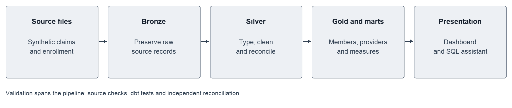
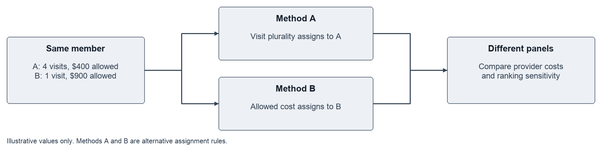
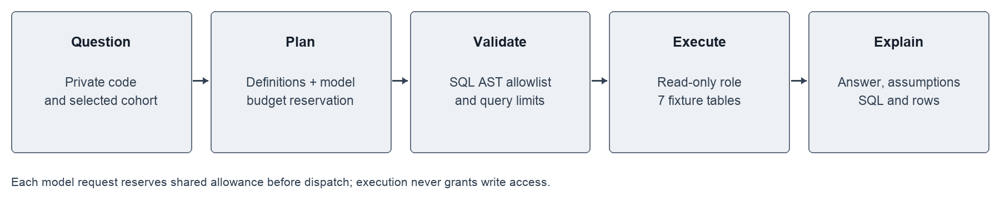

# Medicare Provider Analytics Interview Guide

A concise guide to the problem, implementation, findings and tradeoffs. The project examines how assigning members to providers changes spending comparisons, using synthetic Medicare claims. It combines a reproducible warehouse, provider analytics, a public dashboard and an access-controlled text-to-SQL assistant.

## 1 Explain the project in one minute

“I built a provider analytics pipeline using 23 million rows of synthetic Medicare data covering 232,747 members. I cleaned and reconciled the claims in PostgreSQL and dbt, then compared two ways of assigning members to providers: office-visit frequency and professional allowed cost. Between 35.2% and 52.4% of common qualifying providers moved at least three cost deciles when the assignment method changed. I also built an interactive dashboard and a constrained SQL assistant so someone can explore the findings and inspect the calculations. The main lesson is that the definition of a provider’s patient panel can substantially change its apparent performance.”

Use this as practice wording. Be prepared to explain each calculation and design choice below.

### What the numbers mean

| Measure | Verified result | Interpretation |
| --- | --- | --- |
| Data scale | 23,004,945 rows; 232,747 members | Synthetic Samples 1 and 2, 2008–2010; rows are not distinct claims |
| Financial validation | 205 reconciliation checks | 151 silver checks and 54 gold checks |
| Missing procedure codes | $41,335,020 paid | Professional payments retained despite missing HCPCS |
| Ranking sensitivity | 35.2%–52.4% moved ≥3 deciles | Common qualifying providers across four sample/year cohorts |
| Readmissions | 3,233 / 49,998 = 6.47% | Eligible index episodes before attribution; observed, not risk-adjusted |
| SQL assistant regression | 78% to 98%; 49/50 in each of 3 final runs | Same 50 cases reused after baseline review; not unseen-test accuracy |

## 2 How the system works

**For a nontechnical reader:** Think of the warehouse as three organized versions of the same source material. Bronze preserves what arrived. Silver resolves formats and claim structure. Gold organizes members, providers and events so the same definitions can be reused in every chart and answer.

**For a technical reader:** Python downloads, profiles and loads source records into PostgreSQL. dbt builds typed silver tables and sample-aware gold facts/dimensions. SQL creates attribution and readmission logic; Python fits a 2008 descriptive cost model before dependent provider metrics. Aggregate exports power the dashboard. Docker and GitHub Actions exercise an isolated fixture pipeline without touching the full warehouse.

### Build sequence and purpose

1. **Acquire and profile:** Verify source identity and file integrity; inspect missing values, dates and monetary fields before modeling.
2. **Load bronze:** Preserve raw fields and source/sample identifiers, with atomic loading to prevent partial datasets.
3. **Build silver:** Type values, resolve multi-segment claims and identify conflicts without silently dropping payments.
4. **Build gold:** Establish member-year and provider grains. Keep sample IDs in keys so two samples cannot collide.
5. **Validate:** Reconcile row counts, monetary totals and joins; use dbt tests plus independent SQL checks.
6. **Calculate measures:** Apply eligibility, attribution, exposure, CCS grouping, readmission and cost-adjustment rules.
7. **Compare and publish:** Analyze rank sensitivity, export provider/aggregate data, and expose charts and restricted SQL exploration.

**Tools and why:** PostgreSQL handles joins and aggregation; dbt makes SQL dependencies and tests explicit; Python handles ingestion, modeling and evaluation; sqlglot inspects SQL structure; Docker isolates builds; Streamlit and static hosting provide two presentation layers.

## 3 The central analytical question

**Attribution** means deciding which provider is responsible for a member’s annual panel assignment. It is an analytic rule, not proof of a clinical relationship.

Illustration only: a member visits Provider A four times and Provider B once, but the allowed professional cost is larger for B. Method A assigns that member to A; Method B assigns them to B. The member’s medical spending then contributes to a different panel. Provider rankings can move even though the underlying claims did not change.

**Actual rules:** A uses distinct office E&M service dates, then latest date, then lowest NPI. B uses known professional allowed amounts, then distinct service dates, then lowest NPI. Neither rule establishes provider specialty. Reportable panels generally require at least 20 members; 10 and 30 are sensitivity thresholds.

**PMPM** means per member per month. Medical PMPM = total inpatient, outpatient and professional Medicare payments / member-months. It excludes prescription gross cost. Sum payments and exposure first; do not take an unweighted average of provider PMPM values. Annual enrollment counts supply an exposure proxy, not verified continuous monthly coverage.

**Rank comparison:** Form each method’s qualifying population, assign ranks/deciles, then intersect providers. A decile is one of ten ordered cost groups. Across the four cohorts, 35.2%, 51.2%, 36.8% and 52.4% of common providers moved at least three deciles. This demonstrates sensitivity to panel composition, not real-world clinical quality.

**Readmissions and expected cost:** Merge overlapping stays and same-day transfers before finding the next admission within 1–30 days. Exclude invalid/conflicted episodes and incomplete follow-up. Cost adjustment uses a 2008 Poisson log-link fit with age, sex and chronic-condition features; observed/expected compares actual with predicted payments. Cost is adjusted; readmission rates are not. AHRQ CCS groups principal inpatient diagnoses into broader condition categories without counting the same stay’s payment multiple times.

## 4 How the AI assistant stays constrained

A visitor enters a private code and a question. The application authenticates first, verifies the fixture and database roles, and supplies measure definitions to the model. Generated SQL is checked structurally before execution through a read-only role. The final answer includes assumptions, SQL and result rows so a reviewer can inspect it.

**Controls:** Seven approved query tables; SQL AST checks; read-only transactions; row/byte limits; query deadlines; and a separate PostgreSQL budget role. A shared $5 lifetime allowance reserves a conservative cost before each API call. Reservations are committed under a database row lock, survive restarts and are not refunded for failures. Rate limits apply across users. These controls reduce risk; they do not guarantee correct model reasoning.

**Evaluation:** A 50-question set includes 45 reference SQL questions and five clarification cases. Baseline strict agreement was 39/50. After prompt corrections, each of three repetitions scored 49/50, or 147/150 overall. Reusing the cases makes this regression evidence rather than held-out generalization. The remaining failure is an equivalent result represented with a different pivot shape. Automated faithfulness review is separate from the still-pending independent human review.

**Two public experiences:** The dashboard displays full Samples 1 and 2 aggregates and free saved SQL examples. The live assistant queries only a deterministic 1,000-member Sample 1 fixture hosted in PostgreSQL. Its smaller scope keeps hosting practical and limits exposure. Never describe live answers as full-population estimates.

## 5 Interview questions and demonstration

**What was the hardest data problem?** Multi-segment facility claims and payments without procedure codes. Explain how conflicting headers are flagged, how joins avoid multiplying payment, and why the $41.3M missing-HCPCS payments are retained for financial reconciliation rather than discarded.

**Why dbt as well as Python?** SQL transformations stay close to the database and have explicit dependencies and tests. Python is used where file handling, statistical modeling or API evaluation is a better fit.

**How did you prove the pipeline was correct?** Grain/uniqueness tests, row counts, monetary reconciliation and independent checks. Explain one invariant, such as medical paid totals surviving a transformation. Passing tests validates the checked properties, not every possible business interpretation.

**What does a provider moving three deciles mean?** Its relative cost group changed after the attribution rule changed. The provider’s patient panel and comparison population may both differ. It is not evidence that care improved or deteriorated.

**Why not claim clinical risk-adjusted readmissions?** The project adjusts cost only. Readmissions are observed claims-based events with date/eligibility exclusions; they lack a planned-readmission exclusion and are not CMS risk-standardized measures.

**How would you improve this?** Add a genuinely held-out question set, complete human review, test broader query patterns, and evaluate alternative attribution/tie rules. For real data, add appropriate governance, clinical validation and privacy controls before use.

### A three minute demonstration

1. Open the dashboard, select a sample/year and explain PMPM and the panel denominator.
2. Open Method comparison and explain the movement of common providers between deciles.
3. Open a saved SQL example, then show the live assistant’s separate fixture label. A live query requires an access code and uses API allowance; saved examples do not.
4. Inspect an answer’s SQL and caveats. The verified fixture example for Method A in 2009 is $547.87 PMPM, which differs from the full dashboard because the populations differ.

### Links and evidence

- [Public dashboard](https://karthikeyansett1-medicare-provider-performance.static.hf.space/index.html)
- [Live assistant](https://karthikeyans-afjcffkdltc8rije9i7upq.streamlit.app/)
- [GitHub repository](https://github.com/karthikeyansett1/medicare-claims)
- Repository evidence: `analysis/findings.md`, `docs/silver_reconciliation.json`, `docs/gold_reconciliation.json`, `assistant/measure_definitions.md`, `eval/results/final_evaluation_summary.json` and `deployment/live/verification.json`.
